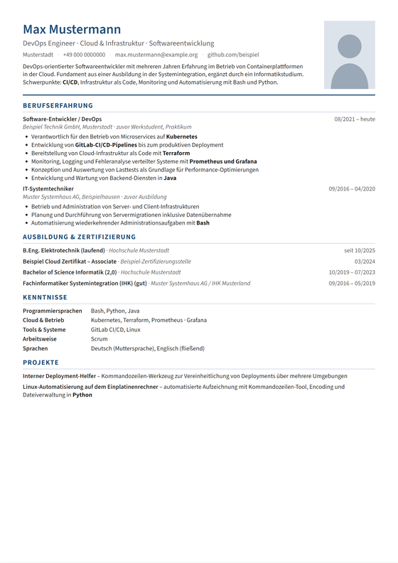
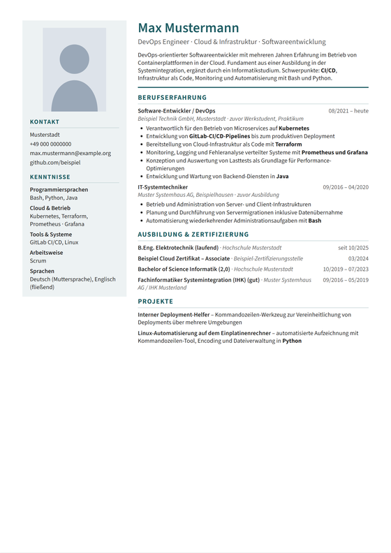
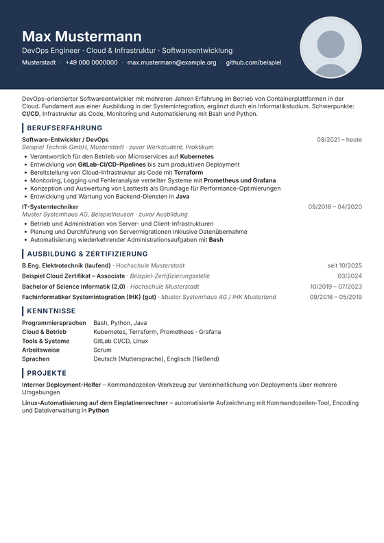

# Bewerbungs-Werkstatt

Bewerbungsunterlagen aus eigenen, geprüften Fakten – in wenigen Minuten an jede Stellenausschreibung angepasst, mit [Claude Code](https://claude.com/claude-code).

Du pflegst einmal deine **Stammdaten**: Stationen, Tätigkeiten, Abschlüsse, Skills, jeweils mit Beleg. Für eine Stellenausschreibung wählt Claude daraus das Passende, stellt es in den Vordergrund, formuliert es mit den Begriffen der Anzeige um und erzeugt ein PDF. Dabei gilt eine feste Regel: **Jede Aussage im Lebenslauf stammt aus deinen Stammdaten.** Claude formuliert um, erfindet aber nichts. Fehlt etwas, das die Anzeige verlangt, fragt Claude nach, statt es dazuzuschreiben.

| klassisch | zwei-spalten | kopfband |
|---|---|---|
|  |  |  |

<sub>Alle drei mit denselben Beispieldaten einer erfundenen Person.</sub>

## Datenschutz zuerst

- Deine Daten liegen in einem eigenen Ordner `daten/`. Er ist ein **eigenes Git-Repo** und gehört nie in dieses öffentliche Repo, denn `.gitignore` schließt ihn aus.
- Standardmäßig bleibt `daten/` **nur auf deinem Rechner**. Wenn du ein Backup auf GitHub willst, dann nur in einem **privaten** Repo. Die Einrichtung prüft das.
- Die Inhalte gehen an Claude, wenn du mit Claude Code arbeitest, genau wie bei jeder anderen Datei, die du Claude zeigst.

## Voraussetzungen

- [Claude Code](https://claude.com/claude-code) (Abo Pro oder höher)
- Python ≥ 3.10
- git
- Chrome, Edge oder Chromium (für die PDF-Erzeugung)

Ein GitHub-Account ist **nicht** nötig. Was fehlt, meldet `einrichten.py` mit dem passenden Installationsbefehl für Windows, macOS oder Linux.

## Installation

```bash
git clone https://github.com/S4mb0/bewerbungs-werkstatt.git
cd bewerbungs-werkstatt
python einrichten.py        # macOS/Linux: python3 einrichten.py
```

Dann den Ordner in Claude Code öffnen und sagen:

> Richte mich ein.

Der Skill `einrichten` führt durch alles Weitere. Halte am besten deinen bisherigen Lebenslauf (PDF oder Word) bereit, dazu Zeugnisse und ein Bewerbungsfoto, falls du eins verwenden willst. Du kannst jederzeit abbrechen und später weitermachen.

## Die Skills

Skills sind Abläufe, die Claude Code in diesem Ordner kennt. Du rufst sie nicht mit Befehlen auf, sondern sagst einfach, was du willst.

### `einrichten`: der erste Start

> Richte mich ein. · Hier ist mein alter Lebenslauf: ~/Dokumente/lebenslauf.pdf

Er legt `daten/` an, wahlweise nur lokal oder zusätzlich in einem privaten GitHub-Repo. Dann erfasst er Person und Foto und liest deinen bisherigen Lebenslauf und Zeugnisse ein. Ohne Dokumente fragt er im Interview ab. Was unklar ist, fragt er nach. Mit dir zusammen legt er **Schwerpunkte** fest, also die Richtungen, in die du dich bewirbst, und die **Kategorien** deiner Kenntnisse. Am Ende stehen ein Template und je Schwerpunkt ein **Standardlebenslauf**, den du freigibst.

### `lebenslauf-anpassen`: für eine konkrete Stelle

> Hier ist eine Stelle: https://example.org/jobs/123 · Kürz die Projekte, nimm dafür die Wundversorgung rein. · Passt, freigeben.

Er speichert den Anzeigentext und wählt den passenden Schwerpunkt. In einer Nachricht zeigt er dir:
- das PDF
- die **Treffer**: Anforderung → was im Lebenslauf dafür steht
- die **Lücken** als Fragen
- was er beim Kürzen gestrichen hat

Du korrigierst im Chat. Bei der Freigabe legt er die Bewerbung unter `daten/bewerbungen/` ab und fragt, ob gelungene Formulierungen in die Stammdaten übernommen werden sollen. Ziel: höchstens 15 Minuten von der Anzeige bis zur Freigabe.

### `stammdaten-pflegen`: Neues erfassen

> Ich habe letzte Woche die Weiterbildung zur Praxisanleiterin abgeschlossen. · Bei Klinikum X habe ich auch die Dienstplanung gemacht. · Der Eintrag zu Y ist veraltet.

Du erzählst frei, er ordnet zu und fragt nur nach, was für Faktentreue und Pflichtfelder fehlt. Er zeigt dir die Änderung und schreibt sie erst nach deinem OK. Bei Bedarf legt er auch einen neuen Schwerpunkt an.

### `template-pflegen`: das Aussehen

> Mach mir ein Template mit Seitenleiste in Dunkelgrün. · Die Überschriften lieber mit Balken. · Nimm kopfband als Standard.

Ein **Template** ist ein Grundlayout (`klassisch`, `zwei-spalten`, `kopfband`) plus Farbe, Schrift, Fotoform und -position, Stil der Überschriften und Reihenfolge der Abschnitte. Der Skill zeigt dir eine Vorschau mit all deinen Standardlebensläufen, bevor er etwas speichert. Eigene Templates liegen in `daten/templates/`.

## Was wo liegt

```
bewerbungs-werkstatt/            ← dieses Repo (öffentlich, das System)
├── render.py                    YAML → HTML → PDF und alle Prüfungen
├── einrichten.py                Umgebung, Daten-Repo, Migrationen, Updates
├── migrationen.py               Umstellung älterer Daten auf neue Versionen
├── templates/                   Grundlayouts, mitgelieferte Templates, Schriften
├── beispiel/                    Beispieldaten einer erfundenen Person
├── .claude/skills/              die Skills und ihre gemeinsamen Regeln
├── entwurf/, vorschau/          Arbeitsordner (gitignoriert)
└── daten/                       ← deine Daten: eigenes Git-Repo, gitignoriert
    ├── stammdaten/              Person, Foto, Berufserfahrung, Ausbildung, Projekte, Skills …
    ├── standard/<schwerpunkt>/  Standardlebensläufe
    ├── bewerbungen/             versendete Bewerbungen mit Anzeigentext
    ├── anlagen/                 bereinigte Nachweise
    ├── templates/               eigene Templates
    └── einstellungen.yaml       Standard-Template, Schemaversion
```

Alle Daten sind Textdateien (YAML). Du kannst sie auch von Hand bearbeiten; `python render.py --pruefen` sagt dir danach, ob alles stimmt.

## Ohne Claude: die Skripte

```bash
python render.py --pruefen                      # Stammdaten und Lebensläufe prüfen
python render.py daten/standard/<schwerpunkt>   # einen Lebenslauf als PDF erzeugen
python render.py --vorschau kopfband            # alle Standardlebensläufe mit einem Template nach vorschau/
python render.py --daten beispiel beispiel/standard/devops   # mit den Beispieldaten ausprobieren
```

`render.py` startet sich selbst in der `.venv`, die `einrichten.py` angelegt hat. Findet es keinen Browser, hilft die Umgebungsvariable `CHROME` mit dem Pfad. In Containern braucht Chrome oft `CHROME_ARGS=--no-sandbox`.

## Updates

```bash
python einrichten.py --aktualisieren
```

Das holt die neue Version des Systems (`git pull`) und aktualisiert die Python-Pakete. Ändert sich mit dem Update die Struktur der Daten, stellt es `daten/` automatisch um und legt vorher eine Sicherung an: einen Commit in `daten/`, sonst eine Kopie. Deine Daten werden dabei nie überschrieben, weil System und Daten getrennt sind.

Meldet `render.py` „zuerst migrieren“, genügt `python einrichten.py --migrieren`.

## Mitentwickeln

- Tests: `python -m unittest discover -s tests` mit dem Python der `.venv` (`.venv/Scripts/python` bzw. `.venv/bin/python`). Die CI führt sie bei jedem PR auf Windows, macOS und Linux aus.
- **Regel für Datenänderungen:** Wer etwas ändert, das vorhandene Daten ungültig macht (Feld umbenannt, neues Pflichtfeld, Datei verschoben), erhöht die Schemaversion. Dazu gehören eine Migration in `migrationen.py` und Altdaten unter `tests/schemas/v<N>/`. Ein Test erzwingt das. Neue *optionale* Felder brauchen keine Migration.
- Entscheidungen und Begriffe: [SPEC.md](SPEC.md), [GLOSSARY.md](GLOSSARY.md). Die Regeln, an die sich die Skills halten: [.claude/skills/regeln.md](.claude/skills/regeln.md).
- Geplant: Anschreiben aus den eigenen freigegebenen Formulierungen, englische Unterlagen, Bewerbungsmappe als ein PDF.

## Lizenz

Code: [MIT](LICENSE). Die Schriften in `templates/schriften/` stehen unter der [SIL Open Font License](templates/schriften/inter/OFL.txt), siehe die `OFL.txt` je Schrift. Die Beispieldaten sind frei erfunden.
